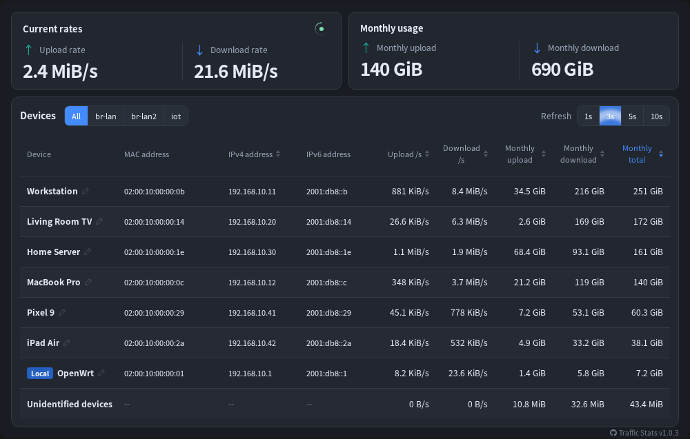
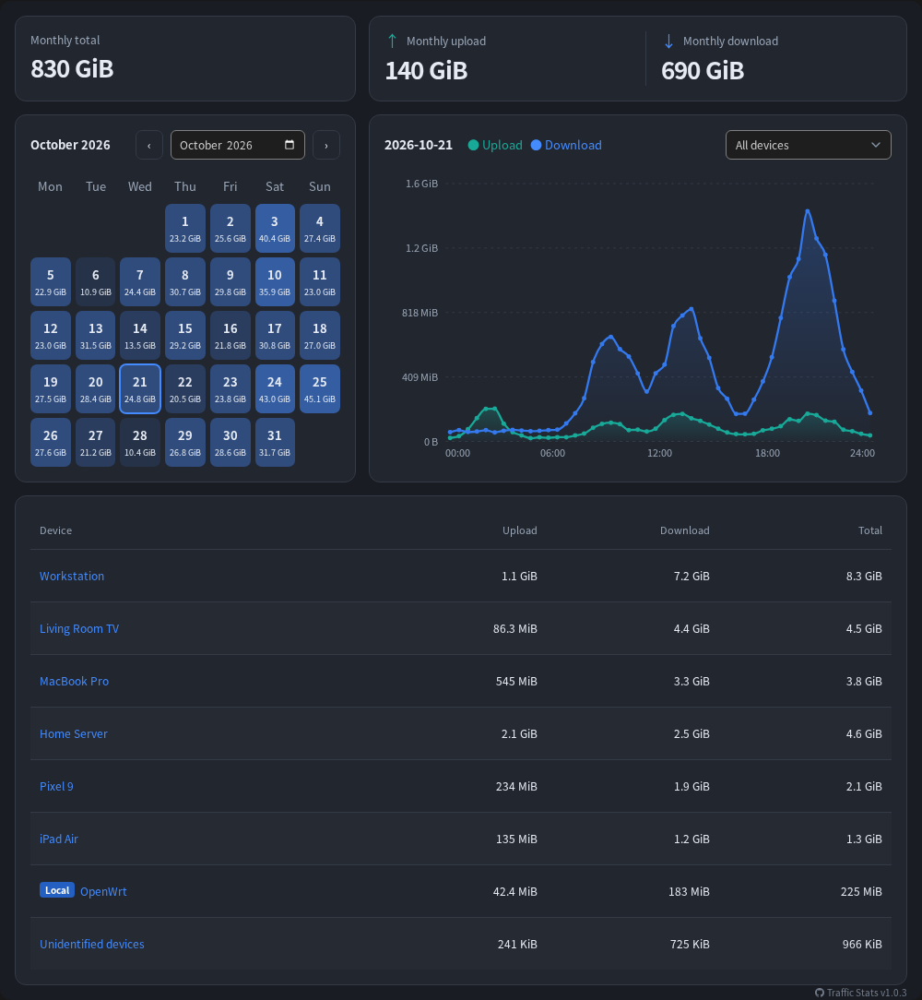

# OpenWrt Traffic Stats

**English** | [简体中文](README.zh-CN.md)

Per-device traffic statistics powered by nftables, with IPv4 / IPv6, multiple LAN/WAN devices, multiple languages, and mobile support.

## Screenshots





## Installation and Configuration

Install `luci-app-traffic-stats` to pull in the `traffic-stats` backend and dependencies automatically. No pip packages are needed. Update both packages when upgrading; collection restarts automatically.

Open **Services → Traffic Statistics → Settings**, select LAN/WAN devices, enable collection, then save and apply. Use actual network device names such as `br-lan` or `eth0`; the two lists must not overlap.

Configuration file: `/etc/config/traffic-stats`.

| Option | Default | Description |
| --- | --- | --- |
| `enabled` | `0` | Collection disabled by default |
| `lan_devices` | `br-lan` | LAN device list |
| `wan_devices` | Empty | WAN device list; configure before enabling |
| `interval` | `5` | Sampling interval, 1–3600 seconds |
| `commit_interval` | `60` | Database write interval in seconds; between the sampling interval and 24 hours |
| `retention` | `3` | Calendar months including the current month; 1–120, or `0` for unlimited retention |
| `proxy_containers` | Empty | Local proxy container names |
| `storage_dir` | `/etc/traffic-stats` | Storage directory |

The database write interval accepts `30s`, `5m`, or `1h` in LuCI. Advanced settings offer Docker proxy container selection with automatic address and published-port tracking. Host networking is excluded; the option is hidden when no eligible containers exist.

## Usage

- **Overview**: Current rates and monthly usage, sorted by total usage by default. With multiple LANs, filter devices without changing global totals or device history.
- **Interaction**: Page refresh defaults to 3 seconds, independently of sampling. Refresh and LAN selections are remembered in the browser. Hover over the status icon for details or click to pin; long names and addresses scroll horizontally.
- **History**: Browse days in the calendar, with one chart point every 30 minutes. Only saved data is shown; hollow points indicate incomplete records.
- **Retention**: Stores 30-minute details and daily totals. Three months means the current month and the previous two; expired details and totals are deleted together.
- **Names**: Click a device name in the overview to edit it. Unicode and spaces are supported. Matching priority is **MAC + IP > MAC > IP**, then rule order. Identical names do not merge devices.

## Accounting Scope

Counts forwarding between selected LAN/WAN devices, the router's WAN traffic, and all client communication with selected proxy containers. Proxy traffic is attributed to clients without counting the container's outgoing forwarding twice. This does not cover all Docker or VPN traffic.

Addresses sharing a MAC belong to one device; unattributed traffic appears under “Unidentified devices”. Flow offloading, hardware acceleration, or traffic bypassing selected paths may cause undercounting. IP-layer usage may differ from ISP billing.

Collection does not backfill earlier traffic. A normal stop saves pending data; power loss or write failures may lose unsaved usage.

## Storage and Backups

The storage directory contains `traffic.db` for usage and `devices.json` for naming rules. It is created automatically, but its parent must exist and external storage must be mounted first. Changing directories copies available original data; existing destination files take precedence.

OpenWrt backups include the default directory; back up custom directories separately. Run `/etc/init.d/traffic-stats stop` before backups or firmware upgrades, and `/etc/init.d/traffic-stats start` after a manual backup.

## Troubleshooting

```sh
/etc/init.d/traffic-stats status
ubus call traffic-stats status '{}'
logread -e traffic-stats
```

## License

[GNU GPL v3.0 only](../LICENSE) (`GPL-3.0-only`).
