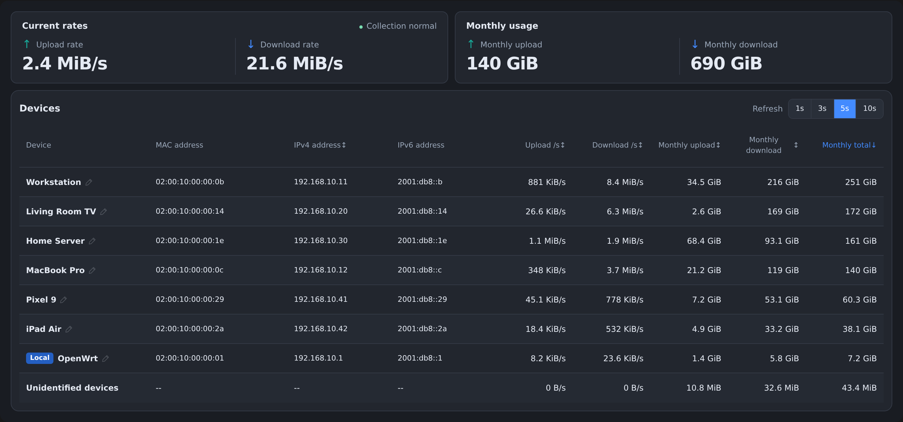
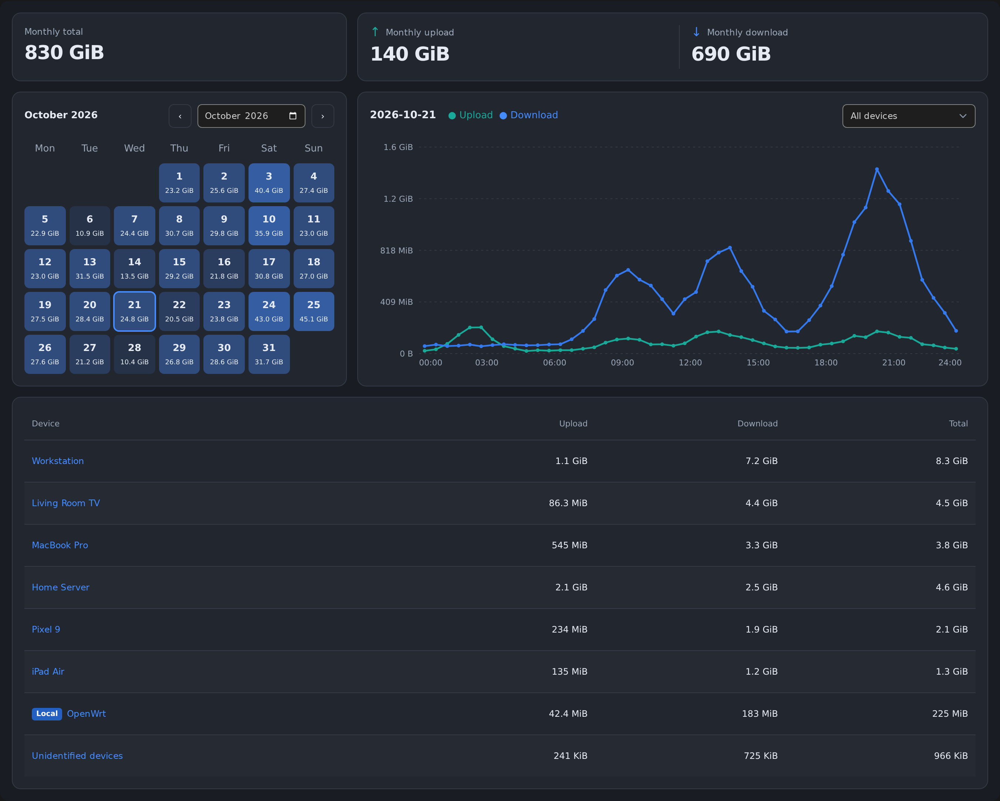

# OpenWrt Traffic Stats

[English](README.md) | **简体中文**

基于 nftables 的逐设备流量统计插件。支持 IPv4、IPv6、多个 LAN/WAN 网络设备，以及多语言和手机浏览器。界面语言跟随 LuCI 设置。

## 截图





## 安装

运行包分为 `traffic-stats` 和 `luci-app-traffic-stats`。后端依赖 `python3-light`、`python3-sqlite3`、`nftables-json`、`uci`、`ubus` 和 `rpcd`，前端依赖 `luci-base`，无需 pip 包。

使用目标固件的软件包管理器安装上述软件包及其依赖。

## 配置

安装后默认禁用。在 **网络 → 流量统计 → 设置** 中选择 LAN/WAN 设备，启用并保存应用。使用 `br-lan`、`eth0`、`pppoe-wan` 等实际 Linux 网络设备名，两侧均可多选，但不能重叠。

配置保存在 `/etc/config/traffic-stats`：

| 配置项 | 默认值 | 说明 |
| --- | --- | --- |
| `enabled` | `0` | 启用采集 |
| `lan_devices` | `br-lan` | LAN 设备列表 |
| `wan_devices` | 空 | WAN 设备列表，启用前填写 |
| `interval` | `5` | 采样间隔，1–3600 秒 |
| `commit_interval` | `60` | 数据库写入间隔，秒；不短于采样间隔，最长 24 小时 |
| `retention` | `3` | 保留的自然月数，包含当月；1–120，`0` 无限保存 |
| `proxy_containers` | 空 | 本机代理容器名称列表 |
| `storage_dir` | `/etc/traffic-stats` | 持久化存储目录 |

LuCI 的数据库写入间隔可填 `30s`、`5m`、`1h`，保存时换算成秒。概览的 1/3/5/10 秒刷新选项只控制页面刷新。

高级设置可多选本机 Docker 代理容器，需要可用的 Docker 服务和命令行。容器地址和宿主机映射端口自动跟踪，不支持 host 网络模式，也不提供手动 IP 输入。

## 统计与历史

- **概览**：显示实时速率和当月用量，月累计包含已写入与暂存用量。设备默认按本月上传、下载之和降序排列，本机正常参与排序。
- **历史**：月历按日浏览，曲线固定为每 30 分钟一个点，显示 0–24 点。只查询已写入的数据，因此可能暂时落后于概览。
- **保留**：保存 30 分钟明细和每日汇总，月总量由每日汇总计算。例如保留 3 个月，即当月和前两个月；过期月份的明细与汇总一起删除，不按月拆分数据库。

统计包含所选 LAN/WAN 间的转发、本机 WAN 流量，以及 LAN 客户端与所选代理容器的通信。代理按客户端侧用量归属，排除容器另一侧的重复转发计数；所选容器的其他客户端通信也会计入。此功能不等同于监控所有 Docker 或 VPN 流量。

同一 MAC 的已识别地址归入同一设备，无法确定归属的流量进入“未识别设备”。流量卸载、硬件加速或绕过所选路径的连接可能造成漏计；统计为 IP 层字节数，不等同于运营商账单。

首次采集建立基线，不补记此前流量。正常停止会写入暂存数据；断电或持续写入失败可能丢失尚未保存的用量。时间变化、计数重置和采集中断会留下质量标记，曲线用空心点表示不完整记录。

## 存储与设备名称

存储目录内的 `traffic.db` 保存流量，`devices` 保存 UCI 格式的名称规则。默认目录自动创建；自定义目录需预先存在，外置存储需先挂载。更换目录时，目标文件不存在且能找到原文件便复制；已有目标文件优先使用。

OpenWrt 备份会包含默认的 `/etc/traffic-stats/` 目录。备份或升级固件前，先执行 `/etc/init.d/traffic-stats stop` 停止采集，确保数据库一致；手动备份完成后再启动。自定义存储目录需单独备份。

点击概览中的设备名编辑名称，支持中文和空格。规则可按 MAC、IP 或两者同时匹配，优先级为 **MAC + IP > MAC > IP**，同级按配置顺序。名称只影响显示，同名设备不会合并统计。

## 排查

```sh
/etc/init.d/traffic-stats status
ubus call traffic-stats status '{}'
logread -e traffic-stats
```

## 许可证

本项目采用 [GNU GPL v3.0](../LICENSE)，仅限第 3 版（`GPL-3.0-only`）。
